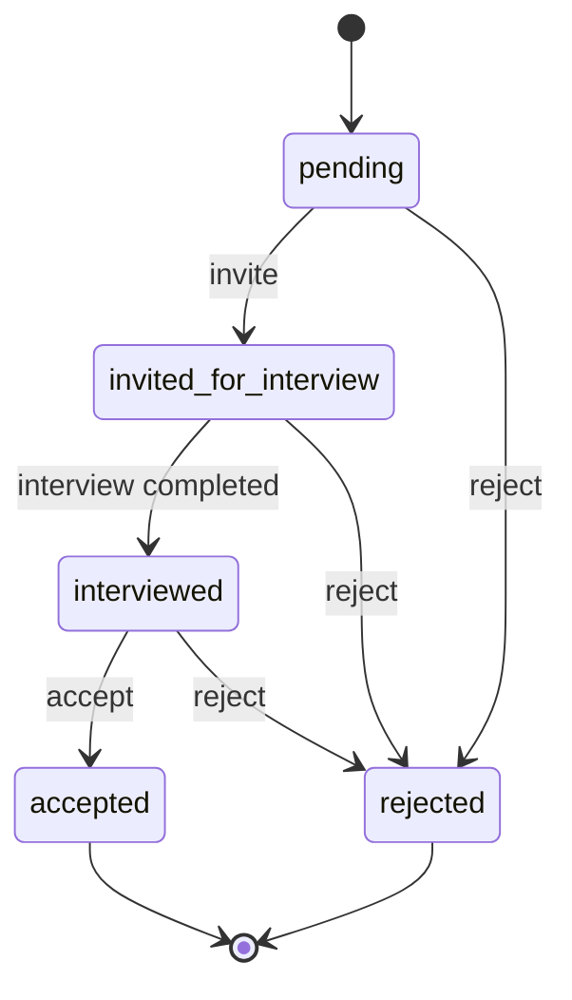

# Product operating model

This document is the shared product and business-analysis contract for Trà Đá Mentor Hub. UI copy, API rules, analytics, and acceptance tests should agree with it.

## Product outcome

Help a mentee move from a qualified application to a productive mentoring relationship with the least coordinator effort and with enough evidence to intervene early.

### North-star metric

**Productive mentorship starts per cohort:** accepted mentees who complete a first logged session within 14 days of acceptance.

This cannot be calculated reliably until cohorts and acceptance timestamps are available for existing records. The application history added to the platform is the first required source. Do not substitute total users, page views, or bookings for the north-star metric.

### Guardrails

| Area | Metric | Initial operating target |
| --- | --- | --- |
| Access | Successful sign-ins without support | ≥ 98% |
| Applications | Median time from pending to first decision | ≤ 3 business days |
| Activation | Accepted mentees with first session in 14 days | ≥ 80% |
| Delivery | Scheduled sessions that are logged | ≥ 90% |
| Quality | Sessions with support flag resolved in 3 days | ≥ 95% |
| Capacity | Mentor utilization | 60–85% |

Targets are hypotheses until at least one complete cohort is measured. Owners should review them quarterly.

## Core journeys

1. A prospective mentee reads the public program offer and applies through the official application channel.
2. A coordinator reviews the application and either rejects it or invites the applicant to interview.
3. The interview is scheduled, completed, and explicitly marked as interviewed.
4. A coordinator accepts or rejects the application.
5. An accepted, unassigned mentee is matched to a mentor with visible reasons and capacity constraints.
6. Availability becomes a booking, a booking becomes a session, and a session becomes a log with outcomes and support flags.
7. Coordinators review funnel, capacity, delivery, and support metrics and take action.

## Application state machine

`accepted` and `rejected` are terminal. A reconsideration feature must be introduced as a named workflow with authorization and audit requirements; clients must not reset status through the generic profile API.

## Business rules

- Only administrators and mentors may advance application status.
- The API, not the UI, is authoritative for valid transitions.
- Each status change records its previous state, next state, time, actor ID, actor role, and optional reason.
- Generic mentee profile updates cannot change application status.
- Matching considers only accepted, unassigned mentees and mentors with remaining capacity.
- A booked slot and a completed/logged session are different facts and must not be counted interchangeably.
- Demo integrations must be labeled as demo or disconnected and must never claim an external side effect occurred.

## Definition of done

A feature is releasable only when:

- its user outcome and owner are stated;
- happy path, empty, loading, error, permission, and mobile states are handled;
- authorization and business invariants are enforced server-side;
- the OpenAPI contract and locale catalogs are current;
- unit/integration coverage protects domain rules and Playwright protects the critical journey;
- analytics names, formulas, and data owners are documented;
- logs contain a request ID and no secret or unnecessary personal data;
- rollback and operational impact are understood.

## Decision ownership

| Decision | Accountable role | Consulted roles |
| --- | --- | --- |
| Program offer and cohort policy | Product owner | Operations, mentors |
| Workflow and acceptance criteria | Product + BA | Engineering, QA |
| Domain invariants and architecture | Engineering | Product, Security |
| Interaction and content patterns | Design/Frontend | Product, Accessibility |
| KPI definitions and data quality | Data owner | Product, Engineering |
| Release readiness | Engineering + QA | Product, Operations |

